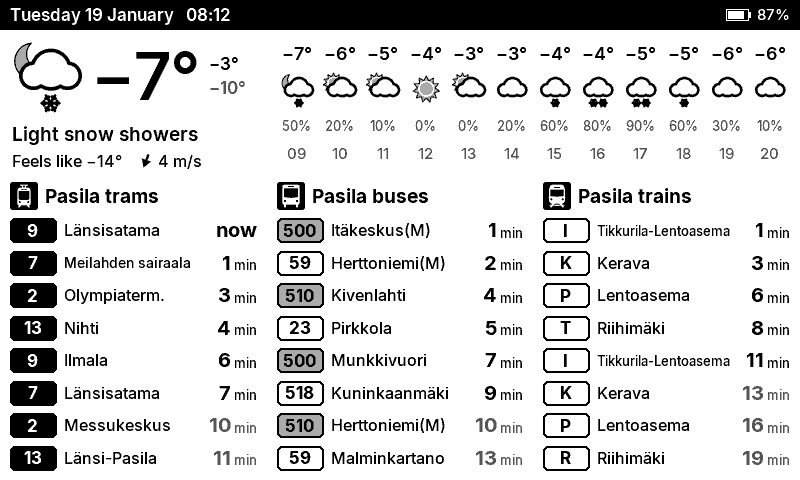
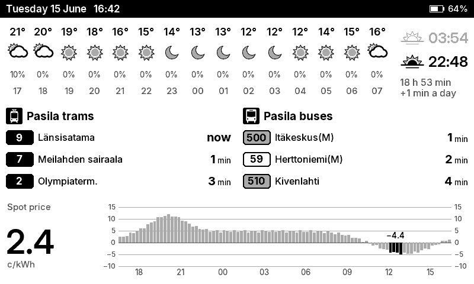
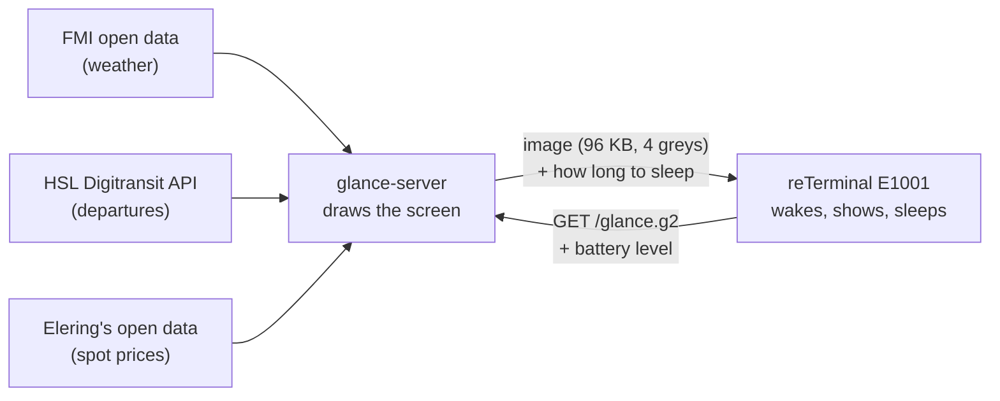

# Glance

A wall-mounted e-paper dashboard for Helsinki: weather from the Finnish
Meteorological Institute (FMI), live public transport departures from HSL,
Finland's electricity spot prices and today's sunrise and sunset, on a battery-powered [Seeed reTerminal E1001](https://wiki.seeedstudio.com/reterminal_e10xx_main_page/)
(7.5", 800×480, 4 greys).



*Rendered by the server's own code from sample data: a winter weekday morning
at Pasila (`mise run screenshot`). On the panel it looks exactly like this.
The interface is also available in Finnish.*



*A second screen on a summer afternoon, from sample data too: a sunny, windy
day, when the spot price falls below zero around midday. The sunrise has
passed, so it is grey.*

## How it works

A small server (a Raspberry Pi will do) fetches the weather, departures and
spot prices, works out the sunrise and sunset, draws the whole screen as an
image and serves it on the home network. The device only wakes up, downloads that image, shows it and goes
back to deep sleep, so its firmware stays simple and its battery lasts.



- **Weather:** current conditions, today's high and low, "feels like", wind,
  and an hourly forecast with chance of precipitation (as many hours as fit:
  12 in the layout above), using FMI's own weather symbols adapted for 4-grey
  e-paper, with a moon in place of the sun in the hours the sun is down. At your location, or at another place in Finland: a town by its
  name (`place = "Mikkeli"`) or a point (`lat`, `lon`), with a heading if you
  like (`name = "Mökki"`).
- **Departures:** as many as fit in each stop widget (8 in the layout above),
  merged across platforms if you like, with HSL's vehicle pictograms.
  Realtime times are black, timetable-only grey; trams have filled route
  badges, trunk buses grey ones.
  Countdowns ("5 min") when the screen updates every minute, clock times
  ("14.32") when it updates less often.
- **Electricity:** Finland's spot price for the quarter hour now, with VAT,
  and a bar per quarter hour for the next 24 hours, the cheapest coming hour
  in black with its price. Tomorrow's prices are published around 14 Finnish
  time; until then the hours still unknown are marked. Nord Pool's day-ahead
  prices, from Elering's open data (no key needed).
- **Sun:** today's sunrise and sunset at your location, beside FMI's sun on the
  horizon, and the day's length with how it changed since yesterday. A time
  already past turns grey. In Lapland's polar night or midnight sun, it says
  so and when the sun next rises or sets. Calculated on the server, so
  nothing is fetched.
- **Battery-aware schedule:** the server tells the device when to wake next
  (e.g. every minute on weekday mornings, every 5 minutes otherwise, every
  15 at night), aimed just after the minute changes so the clock is right.
  Images are drawn in advance so the device's radio is on for as short a time
  as possible.
- **Screens and buttons:** several screens, in decks picked by time of day;
  the two white buttons step through the deck, the green one updates the
  screen with freshly fetched departures.
- **Robust:** stale data is flagged in the status bar; if the server can't be
  reached, the device retries less and less often and marks the screen offline.

## Repository

| Folder | What |
|---|---|
| [`glance-server/`](glance-server/) | Python 3.13 + Pillow. Fetches data, renders the screen, serves it over HTTP; deploy scripts for a Raspberry Pi (systemd user service). |
| [`glance-device/`](glance-device/) | Arduino firmware (PlatformIO) for the reTerminal E1001: Wi-Fi, download, 4-grey drawing, deep sleep, buttons, battery. |
| [`docs/`](docs/) | The screenshots above. |

Both folders use [mise](https://mise.jdx.dev/) for their tools and tasks
(`mise tasks` lists them).

## Getting started

### Server

You need a free Digitransit API key: register at
[digitransit.fi/en/developers](https://digitransit.fi/en/developers/).

```bash
cd glance-server
mise trust && mise install && mise run setup
```

(`mise trust` allows mise to use this folder's `mise.toml`, which defines the
tools and tasks.) Your own settings go in `config.local.toml` (git-ignored),
which overrides `config.toml`. Put the key there first, then find your stops'
codes (as printed on the stop sign) with `mise run stops "stop name"` and add
the rest:

```toml
language = "en"     # the default is Finnish ("fi")

[digitransit]
key = "your-digitransit-key"

[location]          # for the weather and the sunrise and sunset
lat = 60.1987
lon = 24.9327

# The screen: a grid picture of widget names. [widgets], [screens], [decks]
# and [schedule] here replace all of config.toml's examples.
[screens.home]
grid = """
weather weather hours hours hours  hours
trams   trams   buses buses trains trains
trams   trams   buses buses trains trains
"""

[widgets.weather]
type = "fmi_weather_now"

[widgets.hours]
type = "fmi_weather_hourly"

[widgets.trams]
type = "hsl_stops"
codes = ["H0665", "H0664"]   # several codes are merged into one widget
name = "Pasila trams"        # optional; defaults to HSL's stop name

[widgets.buses]
type = "hsl_stops"
codes = ["H2100", "H2101"]

[widgets.trains]
type = "hsl_stops"
codes = ["H0086"]

[schedule]                   # how often the device wakes
wake_interval_minutes = 5

[[schedule.rules]]           # weekday mornings: every minute
days = "weekdays"
from = "07:00"
to = "09:00"
every = 1
```

`config.toml` documents the rest: language (`en`/`fi`), the widget types and
their settings, more screens and decks of screens to switch between, the
schedule, refresh intervals.

A weather widget for another town takes its name, and a heading if you like:

```toml
[widgets.mikkeli]
type = "fmi_weather_hourly"
place = "Mikkeli"   # or a point: lat = 61.69 and lon = 27.27
name = "Mikkeli"    # optional heading
```

FMI looks the name up. Where several places share it, FMI picks one, and the
server's log says where ("weather for Koski updated: … at 61.0222, 25.1542");
a fuller name such as "Koski Tl" picks another. A name FMI doesn't know is
said on the widget itself. `mise run render -- --screen NAME` draws one
screen to `glance.png`.

```bash
mise run serve    # preview at http://localhost:8080/
mise run test
```

### Raspberry Pi

Any Pi on the home network works; it was built on a Pi 1 Model B (the slowest
there is) running Raspberry Pi OS 13. It needs:

- Python 3.11 or newer, which Raspberry Pi OS 12 has. It has only been run on
  Raspberry Pi OS 13 (Python 3.13, Pillow 11), though: on an older release
  neither the drawing nor the sandboxed service has been tried.
- A fixed address: reserve one for it in your router's DHCP settings. The
  device is given the server's IP address, not its name.
- SSH key login from your machine (`ssh-copy-id pi@raspberrypi.local`): the
  deploy connects several times and would ask for the password each time.

Once, on the Pi:

```bash
sudo apt install python3-pil python3-venv rsync && sudo loginctl enable-linger $USER
```

Then, on your machine, set the target in `glance-server/mise.local.toml`
(git-ignored; see `mise.local.toml.example`) and deploy:

```toml
[env]
GLANCE_PI = "pi@raspberrypi.local"
```

```bash
mise run deploy   # runs the tests first, then copies and (re)starts the service
```

The server then runs as a sandboxed systemd user service on port 8080 and
starts at boot. Its log: `journalctl --user-unit glance -f` on the Pi. Open
`http://SERVER-IP:8080/` in a browser to see the dashboard before setting up
the device.

### Device

The firmware replaces the reTerminal's stock SenseCraft firmware (Seeed's web
flasher can restore it). Copy `glance-device/include/secrets.h.example` to
`glance-device/include/secrets.h` and fill in your 2.4 GHz Wi-Fi and the
server's IP address (`http://SERVER-IP:8080/glance.g2`). `platformio.ini`
expects the reTerminal's serial port under its macOS name; on Linux or Windows
change `upload_port` and `monitor_port` there as its comment says (on Linux
your user also needs access to serial ports, usually the `dialout` group).
Then, with the reTerminal on USB-C:

```bash
cd glance-device
mise trust && mise install
mise run upload
mise run monitor   # the device's log
```

## Security

Glance is made for a home network you trust, and should stay there:

- The server has no login and speaks plain HTTP. Anyone on the network can see
  the dashboard, which shows the stops near your home. **Don't forward its
  port to the internet.** As a backstop the server refuses requests from
  public addresses; if you reach it from another range (a VPN's, say), add
  it to `[server] allowed_networks`.
- The server refuses requests that call it by an unexpected host name, so a
  web page can't read the dashboard through your browser. IP addresses,
  `.local` names and single-word names work; add any other name to
  `[server] hostnames` in `config.local.toml`. A web page can't send it a
  false battery level or a refresh either: those count only in requests
  carrying a header that the device and the preview page add.
- On the Pi the service runs sandboxed: it can read its own folder and write
  its cache, nothing else in your home directory.
- Your Wi-Fi password is stored in the device's firmware, where someone with
  the device and a USB cable could read it. If that worries you, put the
  device on a guest or IoT network that can reach the server.
- `config.local.toml` and `secrets.h` hold your key and password: they are
  git-ignored; keep them readable only by you (`chmod 600`).

## Development

`CLAUDE.md` holds the architecture and the rules the project is worked by, and
the `CLAUDE.md` in each folder the design decisions and measurements behind
that part (the project was built with Claude Code). `mise run hooks` in
`glance-server/` makes every `git push` that changes the server run its tests
first, and stops the push if one fails (once per clone). `mise run icons` rebuilds the icon PNGs
from their SVG sources (macOS only); `mise run screenshot` re-renders the screenshots above.

## Licence

MIT, see [`LICENSE`](LICENSE). The bundled fonts and icons keep their own
licences, the weather and transport data are CC BY 4.0, and the electricity
prices are Nord Pool's, published by Elering: see
[`THIRD_PARTY.md`](THIRD_PARTY.md). This project is not affiliated with HSL,
FMI, Nord Pool, Elering or Seeed Studio.
